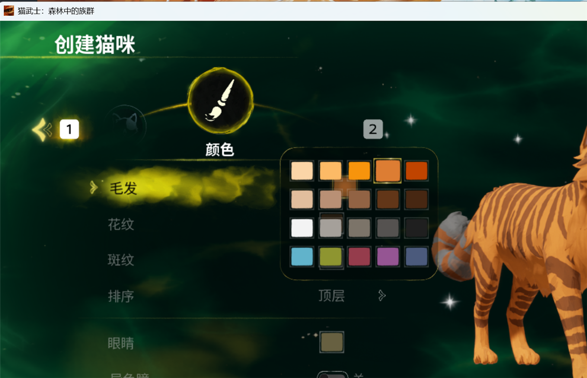
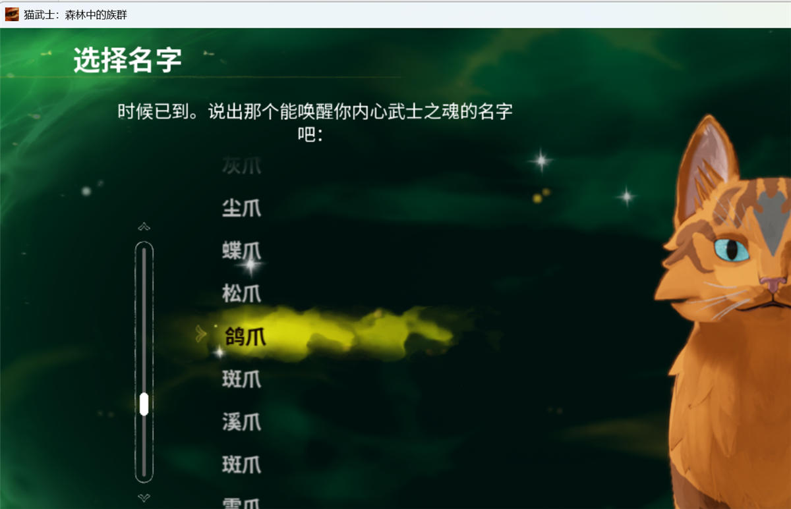

# 猫武士：森林中的族群 — 简体中文汉化 / Warrior Cats: Clans of the Forest — Simplified Chinese Mod

**人机合作非官方粉丝汉化 · 免费发布 · v0.1.2**

> 适用游戏：`Warrior Cats: Clans of the Forest`（Steam AppID **3960600**）
> 对应游戏构建：2026-10（UE 5.7 / Bamtang）
> 本汉化不修改游戏 exe，只以补丁 pak 覆盖文本与字体，可随时安全卸载。

## ✨ 功能

- **全文本汉化**：8,901 条游戏文本（主菜单 / UI / 设置 / 教程 / 战斗 / 任务 / 对白 / 成就 / 物品 / 制作人员名单等），覆盖率 97.7%（剩余为制作人员姓名、`{占位符}`、品牌名等按惯例保留）
- **中文字体**：替换 10 个游戏字体为 Noto Sans SC 子集（SIL OFL 1.1），解决原字体缺中文字形导致的方块
- **猫名本地化**：按《猫武士》中文版命名规则生成 2,438 个猫名
  - 幼崽：小 + 词根（小松鸦）
  - 学徒：词根 + 爪（松鸦爪）
  - 武士 / 巫医等：词根 + 掌 / 心 / 羽 / 毛 / 叶…（松鸦掌、木心）
  - 族长：词根 + 星（火星、松鼠星）
- **安全**：补丁文件名为 `pakchunk0-Windows_P.*`，加载优先级高于原包；不改动任何原游戏文件

## 📸 截图





## 📥 安装（玩家）

1. 到本仓库 **Releases** 下载最新 `WRC-CN-vX.Y.Z.zip` 并解压
2. 把下面 3 个文件复制到游戏安装目录的 `Wrc\Content\Paks\` 下：
   ```
   pakchunk0-Windows_P.pak
   pakchunk0-Windows_P.utoc
   pakchunk0-Windows_P.ucas
   ```
3. 启动游戏（游戏内语言选项保持 **English** 即可显示中文）；若已在运行请重启

> 完整图文说明见包内 `README-安装说明.md`；卸载见 `uninstall_notes.txt`。

## 🗑 卸载

删除 `Wrc\Content\Paks\` 下的上述 3 个文件即可恢复原版；存档不受影响。

## 🔧 从源码构建（开发者）

依赖：
- Windows + [Unreal Engine](https://www.unrealengine.com/) 5.7/5.8 的 `UnrealPak.exe`
- [retoc](https://github.com/trumank/retoc)（UE IoStore 打包工具，自行下载）
- 游戏本体（用于测试安装，不参与构建）

```powershell
# 1) 把 retoc.exe 放到 tools\retoc\retoc.exe
# 2) 运行构建脚本（默认读取 assets/ 下的文本与字体）
powershell -ExecutionPolicy Bypass -File build\build_mod.ps1 `
  -UnrealPak "C:\Program Files\Epic Games\UE_5.8\Engine\Binaries\Win64\UnrealPak.exe" `
  -Retoc ".\tools\retoc\retoc.exe" `
  -OutDir ".\dist"
# 3) dist\ 下生成 pakchunk0-Windows_P.pak / .utoc / .ucas
```

字体可从 Noto Sans SC（OFL）重新子集生成：`build\make_fonts.py`（见 `docs/BUILD.md`）。

## 📁 目录结构

```
assets/strings/     汉化文本 CSV、猫名词素表、术语表
assets/fonts/       10 个中文字体 .ufont（Noto Sans SC 子集，OFL）
assets/marker/      补丁包根标记文件
build/              构建脚本
docs/               说明与截图
release/            发行版文档（安装/卸载/校验清单）
LICENSES/           第三方许可（OFL）
```

## ⚠️ 已知限制

- 语音仍为英文（原游戏语音资源未改动）
- 贴图内嵌英文（如部分背景图上的文字）无法通过文本替换
- 制作人员名单中的人名保留英文；平台品牌名（Steam/Epic/XBOX/PlayStation 等）保留
- 游戏更新后文本键可能变化，汉化可能失效，请关注 Release 更新

## 🤝 制作方式 / How it was made

本项目为**人机合作（human–AI collaboration）**成果：

- **人类（[@GiftsfromtheRiver](https://github.com/GiftsfromtheRiver)）**：发起项目、提供游戏环境与实机测试、确定翻译风格与《猫武士》命名规则、审校反馈（如技能弹窗措辞、猫名规则）、发布与维护。
- **AI（DeepSeek Harness 编码代理 / deepseek-flash）**：游戏数据解包与格式逆向、8,901 条文本翻译与占位符校验、字体子集化与 `.ufont` 封装、补丁打包与 44 项安装校验、文档与工具脚本编写。

翻译文本由 AI 生成、经人类抽检与反馈修订；工程实现全部在本机完成，**未使用任何现成汉化包**。

This project is a **human–AI collaboration**:

- **Human ([@GiftsfromtheRiver](https://github.com/GiftsfromtheRiver))**: initiated the project, provided the game environment and in-game testing, set the translation style and *Warrior Cats* naming rules, reviewed feedback (e.g. skill-popup wording, cat naming), and handles publishing/maintenance.
- **AI (DeepSeek Harness coding agent / deepseek-flash)**: game-data extraction and format reverse-engineering, translation of 8,901 strings with placeholder validation, font subsetting and `.ufont` repacking, patch packaging with 44-point install verification, documentation and build tooling.

Translations were AI-generated and human-reviewed; all engineering was done locally. **No existing localization pack was used.**
## ⚖️ 免责声明 / Disclaimer

本项目为**非官方、非营利粉丝汉化**，与 Working Partners Ltd、Coolabi、Bamtang Games、Steam 无关。
游戏原文与角色版权归其权利方所有；本项目**不包含任何游戏原始素材**（仅含自制翻译文本与 OFL 开源字体的子集）。
若权利方认为不妥，请联系删除，将在收到通知后立即下架。请支持正版游戏。

This is an unofficial, non-commercial fan translation. It is not affiliated with Working Partners Ltd, Coolabi, Bamtang Games or Steam. The mod contains **no original game assets**—only our own translated text and a subset of the OFL-licensed Noto Sans SC font. All rights to the original game belong to their respective owners. Contact for takedown.

## 📄 许可

- 构建脚本/工具代码：MIT（见 `LICENSE`）
- 翻译文本：粉丝翻译，仅供配合正版游戏免费使用
- 字体：Noto Sans SC，SIL OFL 1.1（见 `LICENSES/OFL-NotoSansSC.txt`）

## 🙏 致谢

- [retoc](https://github.com/trumank/retoc) — UE IoStore 工具
- [Noto Sans SC](https://fonts.google.com/noto/specimen/Noto+Sans+SC) — SIL OFL 1.1
- 《猫武士》系列及所有译名参考
